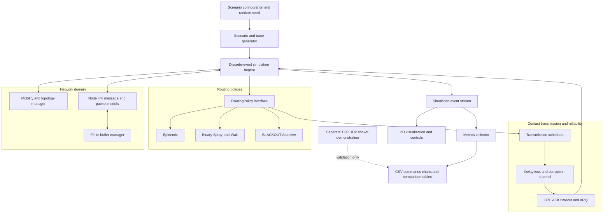
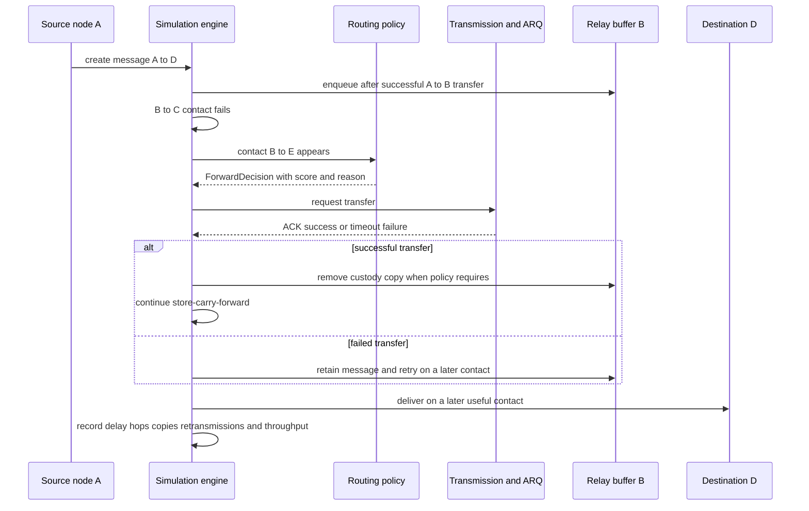

# BLACKOUT Adaptive Network Simulation Architecture

## 1. What the project is

BLACKOUT is an educational Delay-Tolerant Network and opportunistic-network simulator. It models nodes that move, lose links, become partitioned, and regain contact later. When no useful next hop exists, a node keeps the message in a finite buffer. When a useful contact appears, it forwards the message. This is store-carry-forward communication.

The simulator compares three policies under the same mobility, failure, traffic, and random-loss trace:

1. Epidemic Routing replicates a message to eligible encountered nodes.
2. Binary Spray-and-Wait starts with a fixed copy budget, splits that budget during the spray phase, and uses direct delivery when a holder has one copy left.
3. BLACKOUT Adaptive Routing uses one custody copy and transfers it to a better relay according to an explainable score.

The project does not implement PF-DTN, DCRP, MFRD, or the Bundle Protocol. PF-DTN motivates the general separation between context collection, prediction or utility calculation, and relay selection. BLACKOUT deliberately replaces PF-DTN's LSTM and uncertainty machinery with a small, interpretable heuristic suitable for a semester project.

## 2. Architectural principles

- Use simulated time, not wall-clock time.
- Keep routing, link reliability, visualization, and experiments separate.
- Replay the same scenario trace for every routing policy.
- Make routing policies interchangeable through one interface.
- Let the UI observe events; it must not contain routing logic.
- Count routing copies separately from link-level retransmissions.
- Treat node IDs and simulated IP addresses as different concepts.
- Keep optional socket, Wireshark, Packet Tracer, and Mininet demonstrations outside the core simulator.

## 3. High-level architecture



## 4. Runtime data flow



The important boundary is between the two reliability problems:

- DTN routing decides which encountered node should carry a message next, possibly after a long wait.
- ARQ decides whether one transfer over one currently available link succeeded and whether it must be retransmitted.

A link-level ACK is only valid while that simulated contact can return the ACK. End-to-end delivery receipts are a separate optional DTN feature.

## 5. Recommended package structure

```text
blackout/
  app.py
  config.py
  events.py
  models/
    node.py
    link.py
    message.py
    packet.py
    buffer.py
  simulation/
    engine.py
    scenario.py
    mobility.py
    topology.py
    failures.py
  routing/
    base.py
    epidemic.py
    spray_and_wait.py
    adaptive.py
  transmission/
    channel.py
    crc.py
    arq.py
    rto.py
  metrics/
    collector.py
    definitions.py
    export.py
  visualization/
    pygame_view.py
    controls.py
  experiments/
    runner.py
    scenarios.py
    plots.py
  socket_demo/
    tcp_demo.py
    udp_demo.py
tests/
configs/
results/
```

### Core responsibilities and interfaces

| Module | Responsibility | Important interface |
|---|---|---|
| `simulation.engine` | Own simulated clock and event queue; process events deterministically | `schedule(event)`, `run(until)`, `step()` |
| `simulation.scenario` | Build nodes, traffic, mobility, failures, and reproducible traces | `build(config, seed) -> Scenario` |
| `simulation.topology` | Calculate contacts from range, movement, and forced failures | `neighbors(node_id, time)`, `link_state(a, b)` |
| `models.message` | Store message identity, source, destination, creation time, TTL, size, hop history, and policy metadata | immutable identity plus controlled status updates |
| `models.packet` | Represent link-transfer units, sequence number, CRC, retry count, and parent message | `verify_crc()` |
| `models.buffer` | Enforce byte capacity, duplicates, expiry, and drop policy | `can_accept(item)`, `put(item)`, `remove(id)` |
| `routing.base` | Common contract for all routing strategies | `on_contact(holder, peer, message, context) -> ForwardDecision` |
| `transmission.channel` | Apply contact bandwidth, delay, loss, corruption, and contact duration | `attempt(transfer) -> ChannelOutcome` |
| `transmission.arq` | ACK, timeout, duplicate suppression, Stop-and-Wait, and later Sliding Window | `send(packets, contact) -> TransferResult` |
| `metrics.collector` | Observe events without changing simulation decisions | `record(event)`, `summary()` |
| `visualization.pygame_view` | Render state and emit user-control commands | `render(snapshot)`, `poll_commands()` |
| `experiments.runner` | Replay traces for each policy and export comparable results | `run_matrix(configs, seeds, policies)` |

`ForwardDecision` should contain `action`, `from_node`, `to_node`, `message_id`, `score_components`, `total_score`, and a human-readable `reason`. This makes the adaptive algorithm visible and viva-friendly.

## 6. Data model

### Node

Required fields: node ID, optional simulated IP address, position, velocity, communication range, operational state, buffer, current neighbors, contact history, and counters.

### Message

Required fields: message ID, source, destination, creation time, size in bytes, TTL, delivery state, hop history, visited nodes, and routing-policy metadata. Epidemic uses copy identity; Spray-and-Wait also stores a copy budget; Adaptive stores the last custody holder and recent-forwarding history.

### Packet

Packets belong to a message and carry sequence number, payload size, CRC, send time, retry count, and duplicate-detection key. Routing operates at the message level. The transmission layer may divide one message transfer into packets. A relay receives custody only after the configured completion rule is met.

For the first working version, use one simulated packet per message. Add multi-packet reassembly only after routing and buffering work. This preserves a clear upgrade path without blocking the main demonstration.

### Buffer rules

- Capacity is measured in bytes.
- Reject duplicates by message ID and copy ID.
- Reject a transfer if free space is smaller than the incoming message size.
- Expire items whose TTL has passed.
- Use drop-oldest-expiring-first as the documented default overflow policy, although rejection is safer for the first version.

## 7. Precise BLACKOUT Adaptive policy

### Candidate eligibility

A peer `v` is eligible only if:

- `v` is in an active contact with holder `u`;
- `v` is operational;
- `v` has enough free buffer for the message;
- `v` does not already hold the same adaptive custody copy;
- the message is not expired;
- the pair is not blocked by the loop/cooldown rule.

If `v` is the destination, forward immediately and bypass scoring.

### Four normalized factors

For destination `d`, simulation time `t`, observation window `W`, and candidate `v`:

1. Connectivity utility

   `C(v,d,t) = 0.7 * min(1, contacts(v,d,W) / K) + 0.3 * degree(v,t) / (N - 1)`

   `contacts(v,d,W)` is the number of completed contacts between `v` and `d` in the last `W` simulated seconds. `K` is the count at which the recent-contact term saturates; use `K = 3` initially. `degree(v,t)` is the number of current neighbors. This is a heuristic utility in `[0,1]`, not a calibrated probability.

2. Destination proximity

   `P(v,d,t) = clamp(1 - distance(v,d,t) / area_diagonal, 0, 1)`

   It rewards geometric closeness. It does not claim that closeness guarantees a future contact.

3. Buffer availability

   `B(v,t) = free_buffer_bytes(v,t) / total_buffer_bytes(v)`

4. Node state

   `S(v,t) = 1.0` when healthy, `0.5` when degraded, and `0.0` when unavailable.

   Unavailable nodes are already excluded. If the simulator does not model a meaningful degraded state, treat node state as an eligibility gate and set its score weight to zero rather than pretending it differentiates candidates.

### Weighted score and forwarding rule

Use configurable weights that sum to one:

`Score(v) = wC*C(v,d,t) + wP*P(v,d,t) + wB*B(v,t) + wS*S(v,t)`

Recommended baseline only:

`wC = 0.35, wP = 0.35, wB = 0.20, wS = 0.10`

These weights are not optimal. Pre-register them as the baseline and test alternatives separately.

The holder computes its own score using the same formula. Transfer custody only when:

`Score(v) >= Score(u) + delta`, with `delta = 0.05` initially.

This hysteresis prevents ping-pong forwarding. Also maintain a short edge cooldown and a visited-node history. If scores tie, prefer higher destination proximity, then more free buffer, then the lexicographically smaller node ID for deterministic execution.

After a successful link-level ACK, the current holder deletes its adaptive copy and the relay becomes the sole custody holder. If transmission or ACK fails, the current holder keeps the copy. This makes the first Adaptive implementation single-copy and prevents uncontrolled replication.

## 8. Routing baselines

### Epidemic

On contact, transfer every non-expired message that the peer does not have and can buffer. Respect contact duration and bandwidth. Count every new replica as a routing copy. Use duplicate detection and a summary-vector-style inventory comparison.

### Binary Spray-and-Wait

Start each message with copy budget `L`, for example `L = 4`. If a holder with `n > 1` copies meets an eligible relay, it transfers `floor(n/2)` copy tokens and keeps the remainder. When a holder has one token, it forwards only to the destination. Record `L` in every result.

## 9. Simulation event model

Recommended events include:

- `NodeMoved`
- `ContactStarted` and `ContactEnded`
- `LinkFailed` and `LinkRestored`
- `MessageCreated`, `Buffered`, `Expired`, and `Dropped`
- `ForwardDecision`
- `PacketSent`, `PacketLost`, `PacketCorrupted`, and `PacketReceived`
- `AckSent`, `AckReceived`, `Timeout`, and `Retransmission`
- `CustodyTransferred`
- `MessageDelivered`

The event stream is the single source for animation, logs, and metric calculation.

## 10. Minimum viable demonstration

The convincing MVP is deliberately smaller than the full proposal:

1. Six named nodes in a 2D Pygame view.
2. Deterministic scripted movement plus an optional random-waypoint mode.
3. Range-based contacts and one forced link failure.
4. Finite byte buffers, TTL, duplicate prevention, and store-carry-forward.
5. Epidemic, Binary Spray-and-Wait, and single-copy Adaptive policies.
6. One-message/one-packet transfers with delay and packet loss.
7. Stop-and-Wait ACK, timeout, and retransmission on an active contact.
8. Live event log showing why Adaptive chose or rejected a relay.
9. Delivery ratio, delay, hops, routing copies, link retransmissions, routing overhead, buffer occupancy, and throughput.
10. CSV output and a batch runner that replays the same trace for all policies.

Add CRC, multi-packet messages, Sliding Window, adaptive RTO, simulated IP/subnetting, and socket demonstrations after the MVP. Hamming correction, Packet Tracer, Wireshark, and Mininet are extensions or validation exercises, not dependencies of the core simulator.

## 11. Broken-route acceptance test

Use a scripted trace so the demonstration cannot fail randomly.

| Time | Event | Expected result |
|---:|---|---|
| 0 | Contacts A-B, B-C, and C-D exist; create message A to D | Message enters A's buffer |
| 1 | A transfers to B | B receives custody/copy according to policy |
| 2 | Force B-C down before B can transfer | Message remains in B's buffer |
| 3-5 | No eligible forward contact | UI shows `stored`, not `lost` |
| 6 | B-E contact starts | Adaptive logs factor values and decision |
| 8 | E-F contact starts | Message moves or remains according to policy |
| 10 | F-D contact starts | Destination receives message |
| 11 | End run | Metrics and full event trace are exported |

Assertions:

- No delivery uses failed link B-C.
- The message is present in B's buffer during the partition.
- A failed packet/ACK retains the sender's custody copy.
- The destination records the message once even after a retransmission.
- Hop count and delay equal the event trace.
- Adaptive logs every candidate's components and rejection reason.

Additional tests should cover a full buffer, expired TTL, duplicate arrival, equal adaptive scores, destination in direct contact, contact ending mid-transfer, ACK loss, zero deliveries, and deterministic replay with the same seed.

## 12. Fair experimental method

### Independent variables

- Routing policy: Epidemic, Binary Spray-and-Wait, Adaptive.
- Node count or density.
- Packet-loss rate.
- Buffer capacity.
- Mobility pattern or speed.
- Failure/partition frequency.
- Spray copy budget.
- Adaptive weights in a separate sensitivity study.

### Controls

- Generate a scenario trace once per seed and replay it for all policies.
- Use identical source/destination pairs, message creation times, sizes, TTLs, mobility, failures, and channel outcomes.
- Use the same simulation duration and buffer accounting.
- Do not tune Adaptive weights on the same runs used for the final comparison.
- Run at least 10 seeds for a class demonstration; target 30 seeds for more stable averages.
- Report the mean, standard deviation, and 95 percent confidence interval when sample size permits.

### Metric definitions

- Delivery ratio: delivered unique messages / generated unique messages.
- End-to-end delay: delivery time - creation time, averaged over delivered messages.
- Hop count: successful custody/copy transfers before first delivery.
- Routing copies: new message replicas created by the routing policy.
- Link retransmissions: repeated packet attempts caused by loss, corruption, or ACK timeout.
- Routing overhead ratio: `(successful forwarding transmissions - delivered messages) / delivered messages`; report undefined when no message is delivered.
- Buffer utilization: time-weighted occupied bytes / total bytes, plus peak occupancy.
- Throughput: unique delivered payload bytes / simulated duration.

Do not combine routing copies and ARQ retransmissions into one number. Do not claim Adaptive wins universally; identify the conditions under which it improves the delivery-overhead trade-off and the conditions under which single-copy forwarding hurts delivery.

## 13. Relationship to PF-DTN

PF-DTN uses three broad phases: contextual mobility collection, LSTM trajectory prediction with Monte Carlo Dropout uncertainty estimation, and adaptive relay selection. It switches between deterministic and probabilistic behavior based on prediction uncertainty and was evaluated using the ONE simulator.

BLACKOUT borrows only the architectural lesson that sensing/context, utility estimation, and forwarding policy should be separate. It does not use an LSTM, Monte Carlo Dropout, predicted flight plans, or PF-DTN's relay-selection algorithms. Its recent-contact and geometric factors are transparent heuristics. This distinction should be stated in the report and viva.

## 14. Decisions to freeze before coding

1. Discrete-event time is recommended over frame time or real time.
2. Adaptive is single-copy custody transfer in version 1.
3. Binary Spray-and-Wait with documented copy budget is the baseline variant.
4. Buffer capacity is measured in bytes.
5. Message routing and packet-level ARQ are separate layers.
6. A contact needs duration and bandwidth; being in range alone does not guarantee a completed transfer.
7. The baseline score weights and hysteresis threshold are configuration, not claimed optima.
8. The UI is an observer/controller, not the owner of simulation logic.
9. Optional real-socket experiments remain a separate module.
10. All comparisons replay common traces and use reproducible seeds.

## 15. Main risks and mitigations

| Risk | Why it matters | Mitigation |
|---|---|---|
| Scope explosion | The proposal combines routing, ARQ, coding, sockets, UI, and external tools | Freeze the MVP and add one extension at a time |
| Unfair comparison | Different random events can make one policy look better | Replay identical traces and channel outcomes |
| Layer confusion | DTN waiting and local retransmission solve different failures | Keep routing and transmission modules separate |
| Fake probability language | A heuristic contact score is not a calibrated probability | Call it connectivity utility and document the formula |
| Ping-pong routes | Similar scores can repeatedly reverse a transfer | Use hysteresis, cooldown, and history |
| Contact too short | A link may disappear before a transfer completes | Model bandwidth, message size, and contact end events |
| Buffer ambiguity | Packet count and byte capacity produce inconsistent results | Use bytes everywhere |
| Duplicate metrics | Epidemic copies and ARQ retries can be double-counted | Maintain separate counters and event types |
| Weight overfitting | Hand-picked weights may only fit one scenario | Pre-register a baseline and run sensitivity analysis |
| UI coupled to logic | Frame rate can alter experimental results | Drive the UI from snapshots of simulated state |

## 16. Implementation status

MVP steps 1-6 are implemented in Python 3.13. The Tkinter GUI also provides the required
live topology, controls, and explainable trace without coupling rendering to simulation
decisions. Pygame and steps 8-10 remain optional extensions.

## 17. Recommended extension order

1. Add CRC and multi-packet transfer.
2. Add Sliding Window and adaptive RTO.
3. Add a Pygame renderer while retaining the same simulation API.
4. Add separate TCP/UDP plus Wireshark demonstrations.
5. Add optional Packet Tracer or Mininet validation.
